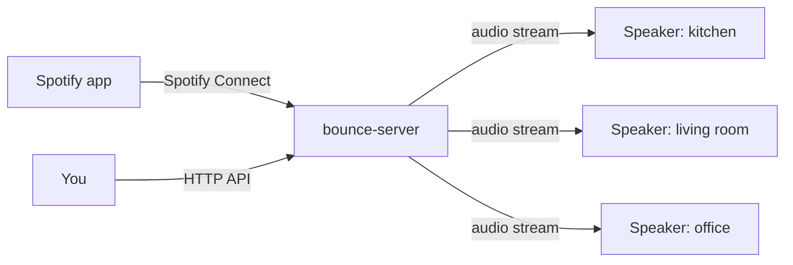

# Bounce

Bounce is a self-hosted, whole-home audio system. You cast music from the
Spotify app to one server on your network. The server sends the audio to
small players wired to speakers in each room, and every room plays in sync.

Bounce has three parts:

- `bounce-server` runs on one machine on your network. It shows up as a
  Spotify Connect device and sends the audio to every speaker.
- `bounce-client` runs on each speaker, for example on a Raspberry Pi Zero
  wired to an amplifier. It finds the server, receives the audio, and
  plays it at the time the server asks for.
- The web UI controls which rooms play and how loud. It is not built yet.
  Until it is, you control Bounce through the [HTTP API](reference/http-api.md).

!!! warning "Early development"
    Bounce is not ready for everyday listening. Speakers play through
    their sound card, but this has not been tested on a Raspberry Pi yet.
    Pages for features that do not exist yet are marked
    **Not available yet**.

## Next steps

- [Set up Bounce](setup/index.md) to run the server and add speakers.
- [Read about the features](features/index.md) to group speakers into
  rooms, set volume, and read speaker logs.
